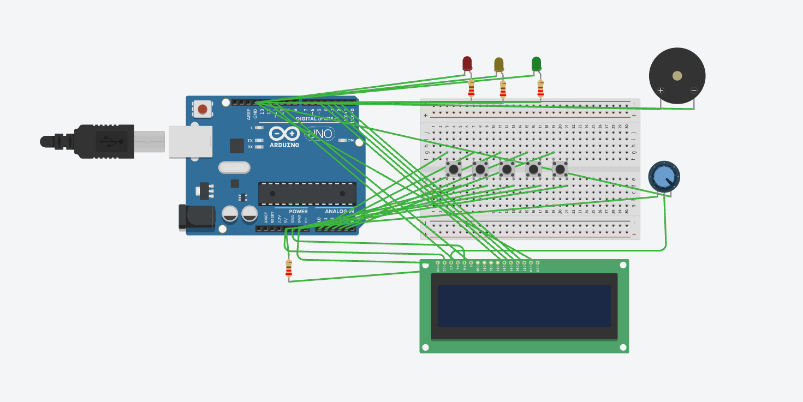

# 💊 Smart Medicine Reminder Box

An Arduino-based smart medicine reminder system designed to help users maintain their medication schedules through timely alerts and visual notifications.

## 📌 Project Overview

The **Smart Medicine Reminder Box** is an embedded-system project developed using Arduino and simulated in Tinkercad. It aims to make medication management easier by reminding users when it is time to take their medicines.

The system uses an LCD display to communicate reminder information and hardware components such as LEDs, push buttons, and a buzzer to provide user interaction and alerts.

This project demonstrates the practical implementation of embedded systems, circuit design, Arduino programming, and basic IoT concepts.

## 🎯 Objectives

- Develop a simple and user-friendly medicine reminder system.
- Provide timely medication reminders.
- Display reminder information through an LCD.
- Use visual and audio alerts to notify users.
- Understand Arduino-based hardware interfacing and simulation.

## ✨ Features

- LCD-based information display.
- Audio notification using a buzzer.
- Visual status indication using LEDs.
- Push-button interaction.
- Scheduled medicine reminder logic.
- Circuit simulation using Tinkercad.
- Arduino-based implementation.

## 🛠️ Hardware Components

| Component | Purpose |
|---|---|
| Arduino Uno | Main controller |
| LCD with I2C module | Displays reminder information |
| Buzzer | Audio notifications |
| Push Button | User interaction |
| LEDs | Visual status indication |
| Resistors | Current limiting and circuit connections |
| Breadboard | Circuit prototyping |
| Jumper Wires | Hardware connections |


## 💻 Software and Technologies

- Arduino IDE
- Tinkercad Circuits
- Embedded C/C++
- Arduino Libraries:
  - Wire.h
  - LiquidCrystal_I2C.h

## 🔌 Circuit Diagram

The complete hardware circuit was designed and tested using Tinkercad Circuits.



### Tinkercad Simulation

[Open the Interactive Tinkercad Circuit](https://www.tinkercad.com/things/apa32ioiE0y-smart-medicine-virtual-show?sharecode=kmBfPPpUHc4eekau2y9t7StQIqyd19l4VLfy8vTPkhk)

## 📂 Project Structure

```
Smart-Medicine-Reminder-Box/
│
├── src/
│   └── medicine_reminder.ino
│
├── circuit/
│   ├── circuit_diagram.png
│   └── tinkercad_simulation.png
│
├── docs/
│   └── components.md
│
├── README.md
├── LICENSE
└── .gitignore
```

## ⚙️ Working Principle

1. The Arduino initializes the connected hardware components.
2. The LCD displays the system status and relevant information.
3. The program checks the configured medicine reminder interval.
4. When a reminder condition is reached, the system activates the notification mechanism.
5. The buzzer and LED provide alerts to the user.
6. The push button allows the user to interact with the reminder system.

## 🚀 Installation and Setup

### 1. Clone the Repository

```bash
git clone https://github.com/vinaysinghkandari01/Smart-Medicine-Reminder-Box-.git
```

### 2. Open the Project

Navigate to the project directory and open:

```text
src/medicine_reminder.ino
```

### 3. Install Required Libraries

Install the required LCD I2C library through Arduino IDE Library Manager.

### 4. Upload the Code

- Connect Arduino Uno to your computer.
- Select the correct board and COM port.
- Verify and upload the code.

### 5. Run the Simulation

Open the Tinkercad circuit using the shared project link and start the simulation.


## 🔮 Future Improvements

- Real-Time Clock (RTC) integration for accurate timekeeping.
- Multiple medicine scheduling.
- Mobile application integration.
- Wi-Fi-based notifications.
- Medicine compartment monitoring.
- Improved user interface.

## 👨‍💻 Author

**Vinay Singh Kandari**

- GitHub: [Click Here](https://github.com/vinaysinghkandari01)

## 📜 License

This project is licensed under the MIT License. See the `LICENSE` file for details.

---

⭐ If you find this project useful, consider giving this repository a star!
